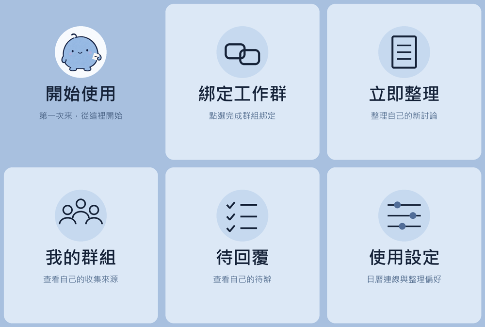

# 公事小精靈｜把對話接成下一步

每天被工作群洗版，真正需要你處理的事卻找不到？公事小精靈幫你整理討論、找出待回覆，再把確認好的安排接到自己的日曆。

[加入 LINE 小精靈](https://line.me/R/ti/p/%40526byspu) · [產品介紹](https://johnny-0120.github.io/line-work-elf/) · [第一次使用教學](https://johnny-0120.github.io/line-work-elf/getting-started.html) · [摘要網頁示範](https://johnny-0120.github.io/line-work-elf/demo.html)

## 聊完之後，知道下一步

- 整理工作討論的重點、決定、待釐清與後續建議。
- 點開個人摘要網頁，閱讀完整內容、搜尋摘要、查看自己的待辦。
- 整理結果預設不推播，想收到短提醒可自行開啟。
- 轉傳或貼上雙人對話，整理你選擇提供的文字。
- 每人各自開通、綁定工作群、連接自己的 Google Calendar。
- 智慧私訊可聊天、查自己的資料；行程新增會進入確認流程。

## 第一次使用

1. 加好友，按「開始使用」，閱讀說明後開通自己的空間。
2. 取得群組成員同意，先把小精靈邀入群。
3. 由本人按群組歡迎卡片綁定，或在私訊按「綁定工作群」分享至目標群。
4. 傳新的工作訊息，回私訊按「立即整理」，再開啟自己的摘要網頁。

連結只能短時間使用，持有者可以查看你的內容，請勿轉傳。摘要不會公開上傳到這個網站。

## 目前免費試用

不需要購買方案或提供信用卡。個人與全站額度、LINE 配額與服務在線狀態會影響可用性。可在使用設定查看用量。現在沒有付款或自動續訂功能。

這個公開 repo 現在是產品介紹與使用者文件入口。後端程式另行維護，不在目前分支發行；既有公開版本的 Git 歷史仍予以保留。

## 資料範圍

只接收機器人已加入且綁定後的新文字，不能自動讀取其他私人聊天室或歷史訊息。每人資料分開保存，服務管理者仍能管理本機檔案。AI 分析會使用外部服務。

[隱私權政策](https://johnny-0120.github.io/line-work-elf/privacy.html) · [使用條款](https://johnny-0120.github.io/line-work-elf/terms.html) · [問題回報](https://github.com/johnny-0120/line-work-elf/issues)

## 從對話到任務

已綁定工作群的新文字會分批辨識可能要做的事，附來源原文。你可以接受、略過或延後一天；接受後才建立自己的任務，不會自動新增日曆或通知群友。網頁提供四種狀態的任務看板、手動新增、期限與負責人欄位，以及逐項開啟的到期 LINE 提醒。跨群關鍵字搜尋可找自己仍保留的七天內原文。

[試用合成資料互動示範](https://johnny-0120.github.io/line-work-elf/demo.html) · [看完整操作教學](https://johnny-0120.github.io/line-work-elf/getting-started.html)

AI 建議需核對原文；每人每日最多六批，另受個人與全站配額限制。檔案／語音理解、Notion、Trello、跨人排程與金流目前未提供。
