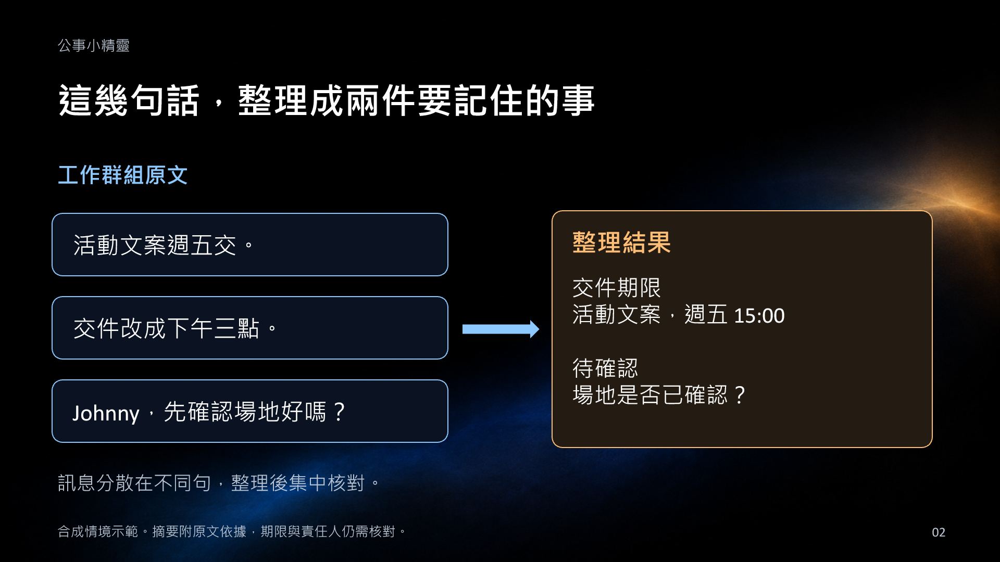
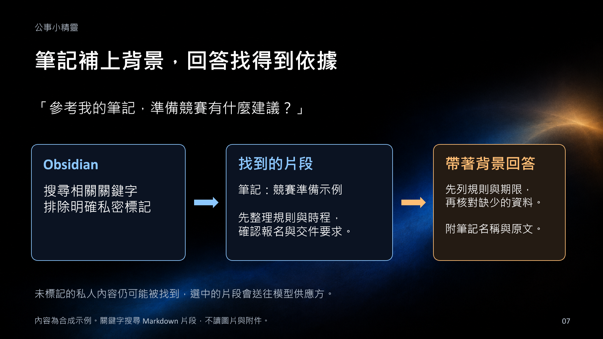
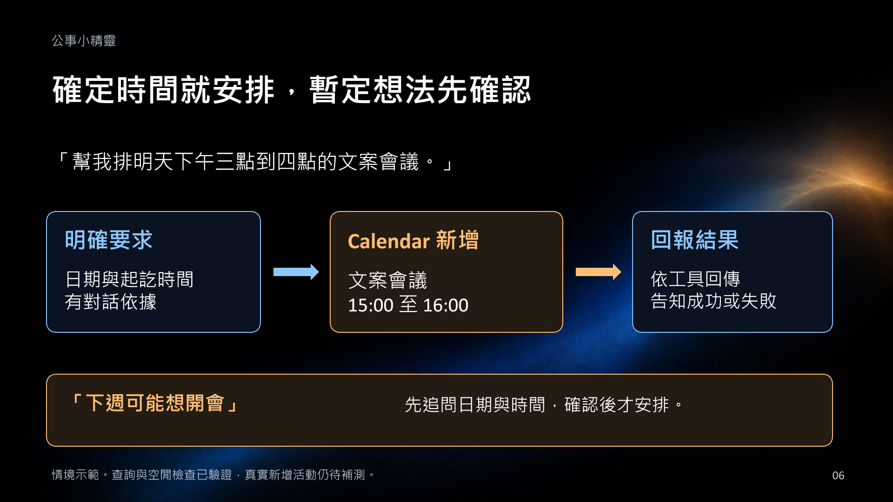
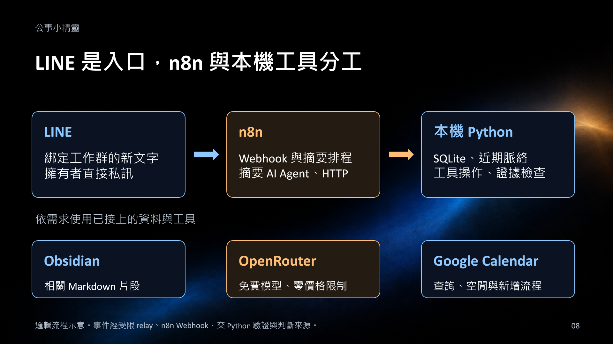

# 公事小精靈｜LINE Work Elf

群組聊完了，誰還記得我要做什麼？用 LINE、n8n 與 OpenRouter 免費模型，整理工作訊息、追蹤待回覆，並參考自己的 Obsidian 筆記回答問題。


這是可自行部署的個人助理原型。你需要自己的 LINE 官方帳號、OpenRouter key，以及選用的 Google OAuth 憑證；本倉庫不包含作者的帳號、訊息、資料庫或筆記。

[10 頁圖文介紹](docs/presentation/README.md) · [使用教學與問題排查](docs/usage.md) · [系統與資料流程](docs/architecture.md) · [下載簡報](https://github.com/johnny-0120/line-work-elf/releases/download/intro-2026-10-23-visual/line-work-elf-illustrated-10pages.pptx)

## 群組聊過的事，整理後接著做

交件期限、改時間與「可以幫忙確認嗎」常出現在不同訊息裡。小精靈接收已綁定工作來源的新文字，整理成公事重點與可能需要回覆的事項，附原文依據讓你核對。每天台北時間 21:00 已設定私訊摘要，也能傳 `/整理` 提前查看。



上圖的對話與輸出是合成示範，沒有使用私人聊天紀錄。待辦完成後可用 `/已處理 編號` 標記；它無法知道你是否已在其他地方回覆。

## 直接說需求，讓它選工具

私訊不用先加「公事：」。工作紀錄、筆記問題與日曆要求會交給對應工具，缺資訊時先追問。Obsidian 採關鍵字搜尋相關 Markdown 片段，回答附筆記名稱與原文，讓問題接得上自己的專案背景。



日曆會區分明確安排與暫定想法。時間不完整就追問，暫定安排先確認，操作後依工具回傳告知結果。目前行程查詢與空閒檢查已驗證，真實新增活動仍待補測。



## 部署完成後，先試這一輪

先完成下方安裝與 Webhook 設定。這個倉庫提供自架原始碼，目前沒有公用的免安裝機器人服務。

1. 邀請自己的小精靈加入工作群，私訊 `/綁定群組`，把取得的一次性指令貼進正確群組並依提示啟用。
2. 群內傳「測試：活動文案週五下午三點交，請我確認場地」，再私訊小精靈 `/整理`。
3. 核對摘要有沒有保留期限與原文依據，用 `/待回覆` 查看事項，處理好再傳 `/已處理 編號`。
4. 私訊「今天有什麼行程？」或「參考我的筆記，整理競賽準備重點」，測試已連接的日曆與筆記工具。


群組啟用後的新文字會自動收集，不必逐句加「公事」。私訊也能直接說需求。收到受理訊息後，仍要確認最終摘要或工具結果。[完整教學](docs/usage.md) 包含預期結果與失敗時的檢查方式。

## 能做什麼

- **工作摘要**：收集已綁定、啟用來源的新文字，設定台北時間每天 21:00 私訊摘要，或用 `/整理` 提前執行。
- **待回覆與待辦**：摘要附原文依據，`/待回覆` 查看，`/已處理 編號` 標記完成。不能得知你在其他地方是否已回覆。
- **自然語言私訊**：不必先打「公事：」。辨識工作、查詢與行程；缺資訊會追問，追問脈絡保留一小時。
- **Obsidian 背景**：關鍵字搜尋相關 Markdown 片段，回答附筆記名稱與原文。排除私密路徑、日記、封存、模板與明確的私密標記。
- **Google Calendar**：查行程與空閒時間，依明確要求安排活動。暫定安排先確認，缺少時間不自動補值；尚不支援修改、刪除或週期活動。
- **本機常駐**：Windows 工作排程器維持服務，處理程序退出、通道網址更新與七天備份。

公開的是自有 Python 程式與 n8n 工作流。n8n 保留 Webhook、摘要排程、AI Agent 與 HTTP 流程；私訊工具、背景檢索、證據檢查與日曆操作在 Python 服務執行。



### n8n 與 Agent 怎麼合作

圖中顯示邏輯分工，實際元件與資料位置見[系統說明](docs/architecture.md)。摘要由 n8n AI Agent 處理，私訊工具在 Python 執行，兩者使用同一套工作資料。

## 開始前

目前提供 **Windows 本機部署**，固定使用 n8n `2.43.7`；不自動升級 n8n，也不附 Docker 部署。準備：

1. Python 3.12 或 3.13，含 `python`、`pythonw` 命令。
2. Node.js 24.x 與 npm。
3. 自己的 LINE 官方帳號，已啟用 Messaging API。
4. OpenRouter API key。選用日曆時，另準備 Google Calendar API 的桌面 OAuth 用戶端。

請放在自己的非雲端同步資料夾。一次只運行一套實例；已經有此工具在運行時，不要從另一個目錄重複安裝監控或搶用相同連接埠。

## 安裝

```powershell
git clone https://github.com/johnny-0120/line-work-elf.git
cd line-work-elf
python setup.py
```

`setup.py` 建立 `.env`，產生隨機內部 token 與 n8n 加密金鑰；已存在的檔案不覆寫。用編輯器填入：

```dotenv
OPENROUTER_API_KEY=你的OpenRouter金鑰
LINE_CHANNEL_SECRET=你的ChannelSecret
LINE_CHANNEL_ACCESS_TOKEN=你的ChannelAccessToken
LINE_CHANNEL_ID=你的ChannelID
LINE_OWNER_USER_ID=你的使用者ID
```

使用者 ID 可在 LINE Developers 的 channel Basic settings 查看 Your user ID。也可等 Webhook 接通後，私訊 `/我的ID` 取得，再填入並重啟。

填好後，先設定你自己的 bot 接收帳號驗證，再安裝服務：

```powershell
python configure_bot.py
./install-local.ps1
```

`configure_bot.py` 向 LINE 取得 bot 身分，寫入本機 `.env` 的 `LINE_BOT_USER_ID`，不顯示識別碼或金鑰。安裝腳本透過 npm 安裝固定版 n8n，匯入工作流和內部憑證，啟動本機服務。

開啟 <http://localhost:5678>，建立自己的 n8n 帳號，檢查「LINE 公事小精靈｜OpenRouter 免費版」並 **Publish／啟用**。憑證如果沒有指派給目前專案，請在 n8n 中重新選取匯入的兩組內部憑證。

| 本機介面 | 位址 |
|---|---|
| n8n 編輯器 | `http://localhost:5678` |
| 小精靈健康檢查 | `http://127.0.0.1:8787/health` |
| 公開入口 relay 健康檢查 | `http://127.0.0.1:8790/health` |
| Google Calendar 連線頁 | `http://127.0.0.1:8791` |

核心與離線測試只使用 Python 標準函式庫。若要產生 LINE 六格圖文選單，另安裝 `python -m pip install -r requirements.txt`，再執行 `python rich_menu.py`。圖檔產生使用 Windows 微軟正黑體。

## 接通公開 Webhook

LINE 需要公開 HTTPS 網址。下載官方 [cloudflared](https://developers.cloudflare.com/cloudflare-one/networks/connectors/cloudflare-tunnel/downloads/)，將 Windows 執行檔放在：

```text
%LOCALAPPDATA%\LineWorkElf\bin\cloudflared.exe
```

執行 `./start-tunnel.ps1`，由 `%LOCALAPPDATA%\LineWorkElf\state\tunnel.log` 取得 HTTPS 基底網址，填入 `.env` 的 `WEBHOOK_URL`，再執行：

```powershell
./stop-local.ps1 -Service n8n
./stop-local.ps1 -Service elf
./start.ps1
python line_api.py --configure-webhook
python line_api.py --test-webhook
```

以上為首次、尚未安裝監控時的設定；只重啟 n8n 與資料服務，保留剛建立的通道。安裝監控後，由監控維持 tunnel 並同步 URL。

在 LINE Developers 開啟 **Use webhook**、**Allow bot to join group chats**；官方帳號管理頁關閉預設自動回覆。Webhook 應為：

```text
https://你的通道網址/webhook/line-work-elf
```

通道只能指向 relay `8790`。不要直接公開 n8n 編輯器、`8787` 資料服務或 `8791` OAuth 連線頁。工作流使用正式 `/webhook/`，不要把 `/webhook-test/` 當成日常入口。

## 常駐與重啟

完成 n8n 匯入與發布，確認 `cloudflared.exe` 已放好，再執行：

```powershell
./install-supervisor.ps1
```

它註冊 `LINE Work Elf Supervisor` 工作排程器：登入 Windows 後啟動，恢復服務程序、維持通道、同步 LINE endpoint，並備份資料。請回 LINE Developers 確認 Use webhook 已開啟，再執行 `python line_api.py --test-webhook`。

日常使用 `./start.ps1` 啟動；`./stop-local.ps1` 完整停止並停用監控。改 `.env` 後完整停止再啟動，避免監控在修改途中重開服務。不要對同一套已運行的實例反覆執行初次匯入。

電腦必須登入且在線。鎖定畫面可運行；手動睡眠、關機或斷網會中斷服務，離線期間的 LINE 訊息不能保證回補。Quick Tunnel 網址會變動，不是固定網域。

## 開始收集群組

1. 邀請你自己的小精靈進工作群組。
2. 私訊 `/綁定群組`，取得一次性指令。
3. 在正確工作群組貼上整行指令，完成來源綁定；再依提示啟用收集。
4. 群內可用 `/工作群組 專案名稱` 設定名稱；之後的新文字不必逐則加「公事」。

| 指令 | 用途 |
|---|---|
| `/整理` | 交給 n8n 整理尚未彙整的公事 |
| `/待回覆` | 查看待辦與待回覆 |
| `/已處理 編號` | 標記完成 |
| `/行程 今天` | 查詢日曆；另支援明天、本週 |
| `/群組`、`/來源紀錄` | 查看收集來源與事件紀錄 |
| `/暫停收集`、`/停止收集` | 暫停或停止並清除該來源的本機資料 |
| `/暫停私訊辨識`、`/恢復私訊辨識` | 控制私訊辨識 |
| `/重試理解` | 重試未完成的 AI 私訊要求 |

## Obsidian 與日曆（選用）

在 `.env` 填入 `OBSIDIAN_VAULT=你的筆記庫完整路徑` 並重啟。只讀 Markdown，最多掃描 500 篇，取最多四篇相關片段，每篇最多 900 字；不是向量檢索或完整附件閱讀。`private: true`、`#private`、私密路徑與日記等會略過，未標記的私人內容仍可能被搜尋到。

Google Calendar：將自己的桌面 OAuth JSON 存成 `%LOCALAPPDATA%\LineWorkElf\state\google-client.json`，開啟 `http://127.0.0.1:8791` 完成 Google 授權。連線使用 Google Calendar events.owned 與 freebusy 權限，程式目前提供查詢與新增；權限本身較廣，可在 Google 帳戶撤銷。憑證與 refresh token 只留在自己的本機。

## 資料、隱私與限制

- LINE 官方 API 無法讀全部個人聊天，也不能自動加入所有群組或回補入群前歷史。群組需逐一邀請且完成綁定。
- 原文、近期對話與相關筆記片段會送往 OpenRouter 和其模型供應方。私事前綴 `私事`／`#private` 先排除，其餘分類仍可能誤判；使用前應讓工作群組成員了解用途。
- 目前不讀圖片、語音、附件、記事本與相簿。不自動替你回覆其他人。
- SQLite 與 OAuth 檔案未額外做應用層加密。原訊息、事件與摘要快照保留七天，待辦三十天；每日備份保留七天，備份也含設定與 OAuth 憑證。
- 原始資料位於 `%LOCALAPPDATA%\LineWorkElf\state`，設定在 repo 本機 `.env`。`.gitignore` 不會阻止 OneDrive 等同步工具，請自行選擇存放位置。
- 每批摘要最多 120 則、約 18,000 字，成功後接續下一批。免費 API 可能限流，格式或證據不符時保留請求重試。
- 對外內部模型名稱固定為 `openrouter/free`；伺服器 `OPENROUTER_FREE_MODEL` 可指定 `:free` 版本，外部呼叫另強制 prompt/completion 最高單價為 0，不接受付費 fallback。這不表示 LINE 推播、主機或其他服務永遠免費。

## 測試與貢獻

測試不需真實金鑰，也不會呼叫真實 LINE、OpenRouter 或 Google：

```powershell
$env:LOCALAPPDATA = Join-Path $env:TEMP 'elf-tests'
$env:ELF_HOME = Join-Path $env:LOCALAPPDATA 'LineWorkElf'
$env:ELF_STATE_DIR = Join-Path $env:ELF_HOME 'state'
python -m unittest discover -s . -p 'test_*.py' -q
```

GitHub Actions 以 Windows／Python 3.12、3.13 執行離線測試與公開檔案掃描。提交前先 `git add`，再執行 `python tools/check_public_files.py`。不要在 issue 附上金鑰、對話、筆記庫、資料庫或 OAuth JSON。詳見 [貢獻方式](CONTRIBUTING.md)。

本專案從個人實作整理而來，功能仍在演進；完整安裝和第三方連線仍需各部署者自行驗證。此公開版只在隔離測試狀態驗證，不附作者的正式執行環境。

## 授權與第三方

本倉庫自有程式與工作流採 [MIT License](LICENSE)。沒有附上 n8n、Node.js、cloudflared 或模型權重；第三方依賴與服務仍依各自授權及條款使用，本倉庫的 MIT 不會變更其授權。n8n 的授權檔請見 [上游 LICENSE.md](https://github.com/n8n-io/n8n/blob/master/LICENSE.md)。

參考：[LINE Messaging API](https://developers.line.biz/en/docs/messaging-api/overview/) · [n8n npm 安裝](https://docs.n8n.io/hosting/installation/npm/) · [OpenRouter](https://openrouter.ai/docs) · [Google Calendar API](https://developers.google.com/workspace/calendar/api/quickstart/python)
