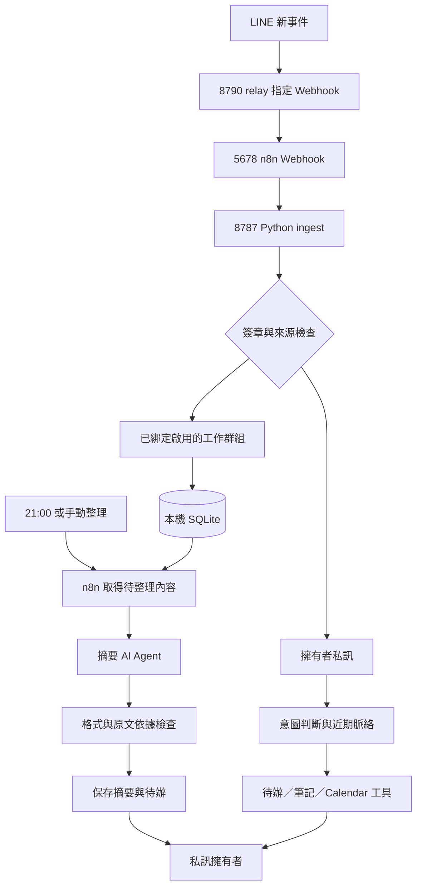
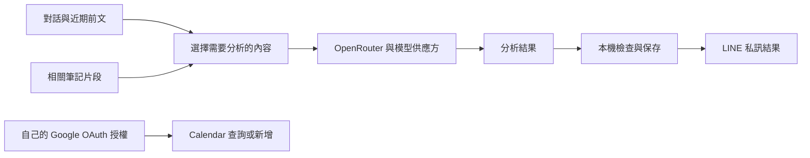

# 系統與資料流程

[專案首頁](../README.md) · [使用教學](usage.md)

## 收訊與摘要的分工

以下是邏輯流程，不是完整 n8n 節點截圖。LINE 事件先進入受限 relay，再由 n8n Webhook 交給 Python `/ingest` 處理簽章、來源與擁有者判斷。

`workflow.json` 包含 Webhook、摘要排程、AI Agent 與 HTTP 節點。安裝腳本會轉成本機服務網址，不要直接把模板中的 `http://elf:8787` 當作 Windows 可用網址。

## 工具能力與限制

| 元件 | 負責內容 | 範圍 |
|---|---|---|
| n8n | Webhook、排程、摘要 AI Agent、HTTP | 私訊工具由 Python 執行 |
| Python | 來源綁定、擁有者授權、脈絡、工具與證據檢查 | 只操作已接上的工具 |
| OpenRouter | 免費模型判斷、摘要與回答 | 零價格上限、不接受付費 fallback，仍可能限流 |
| Obsidian | 相關 Markdown 片段 | 關鍵字搜尋，不讀附件 |
| Google Calendar | 行程、空閒查詢與新增流程 | 暫定先確認，真實新增待補測 |
| Windows 監控 | 維持程序、更新通道網址、備份 | 需要登入且在線 |

## 哪些資料會離開電腦

資料庫存本機，不表示分析都在本機執行。`私事`、`#private` 等明確規則先排除，其餘 AI 分類可能誤判。群組成員應了解用途，筆記也需標記或排除不適合送出的內容。

## 本機檔案與介面

| 位置 | 內容 |
|---|---|
| repo 本機 `.env` | OpenRouter、LINE、內部 token 與本機設定 |
| `%LOCALAPPDATA%\LineWorkElf\state` | 公開版預設 SQLite、狀態與 OAuth 資料 |
| 服務備份 | 設定、資料與 OAuth 憑證，保留七天 |
| `http://localhost:5678` | n8n 編輯器與執行紀錄 |
| `http://127.0.0.1:8791` | Calendar 本機授權頁 |

資料位置可受環境變數影響，以上是公開版預設，不是作者正式環境的私人位置。不要將設定、備份、日誌與資料庫提交 GitHub。對外只公開 relay 的指定 Webhook，編輯器與 OAuth 頁留在本機。

## 驗證狀態

既有紀錄已驗證模擬公事的 n8n 摘要、待辦與私訊，以及真實 Obsidian 問答送達。Calendar 查詢與空閒檢查已有驗證，真實新增活動與每日排程長期運行仍待補測。

公開版附離線測試與 GitHub Actions 設定。離線測試不使用真實憑證，通過不等於各部署者的 LINE、模型與 Google 連線都已完成驗收。
