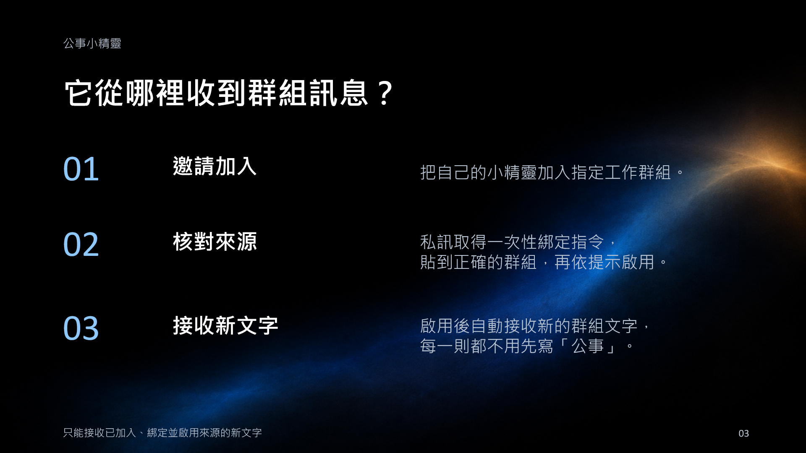
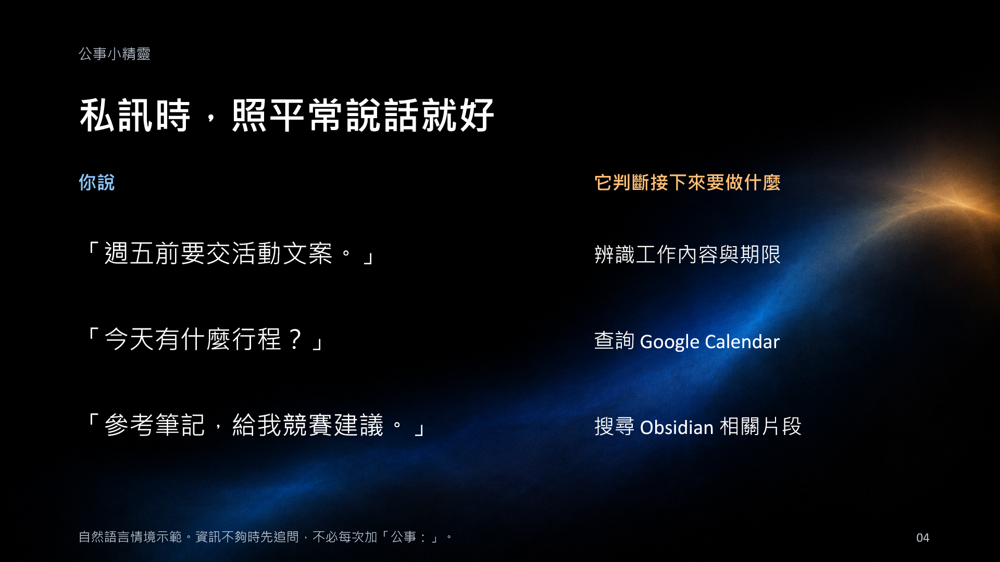
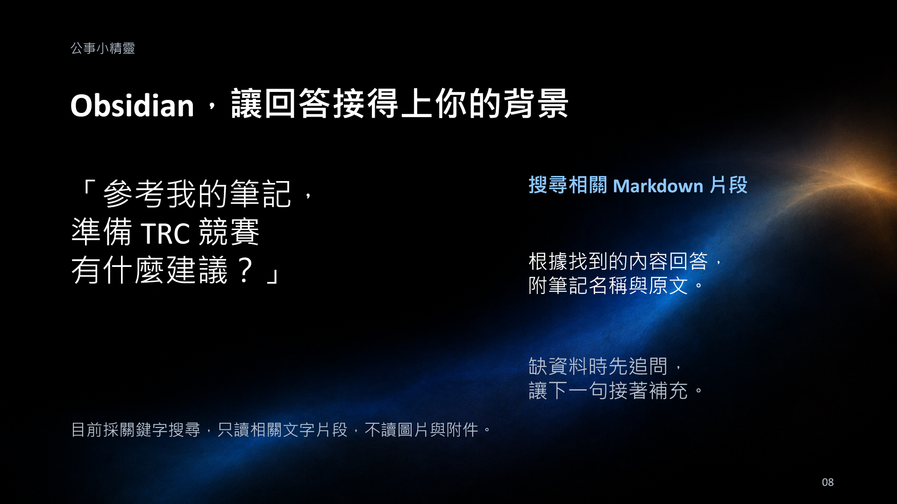
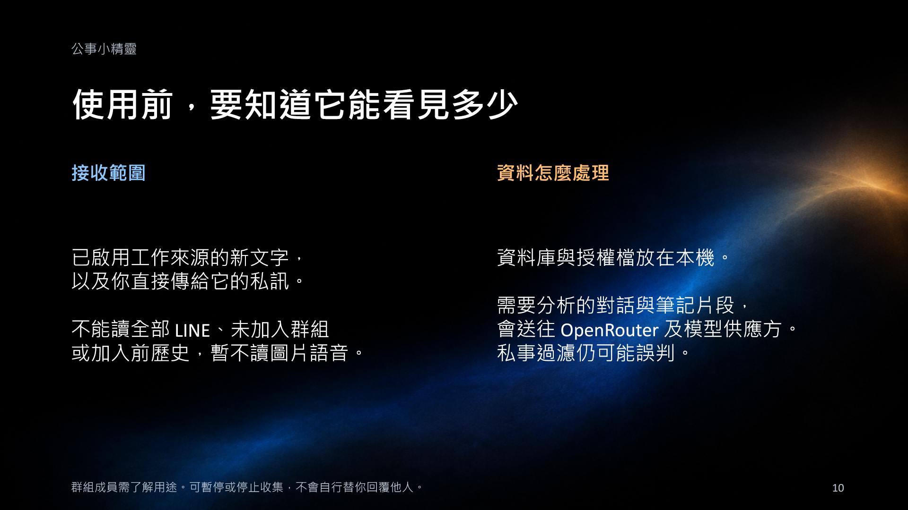
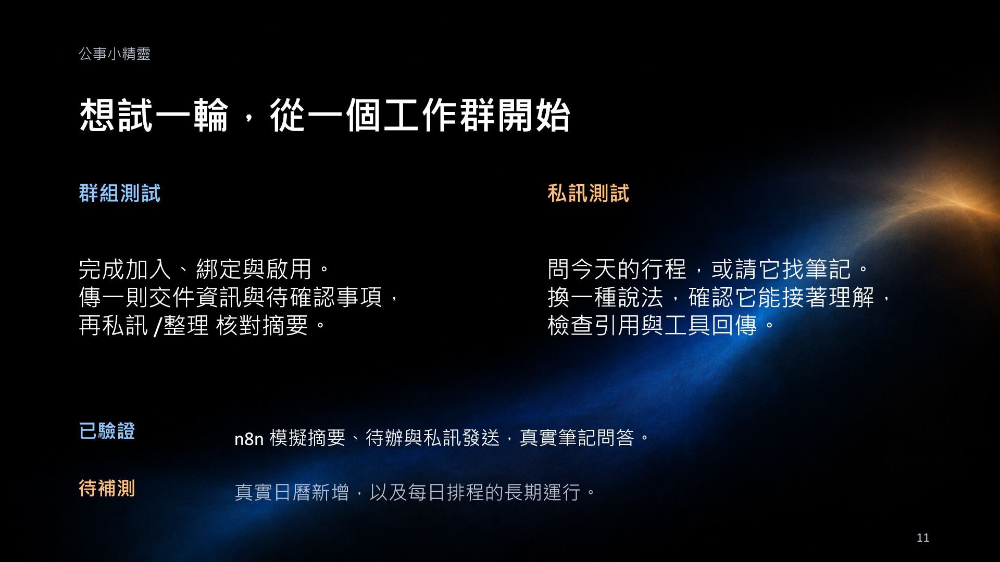

# 公事小精靈工具介紹

[下載可編輯 PowerPoint](https://github.com/johnny-0120/line-work-elf/releases/download/intro-2026-10-23/line-work-elf-introduction.pptx) · [回到專案與安裝說明](../../README.md)

本介紹說明工具用途、互動方式、資料範圍與目前驗證狀態。對話與摘要均為合成情境示範，並非真實聊天紀錄。簡報文字可編輯，背景為 AI 生成的裝飾圖像。

## 群組聊完之後

## 開始接收與互動

## 日曆與自己的筆記

## 資料範圍與自行試用

